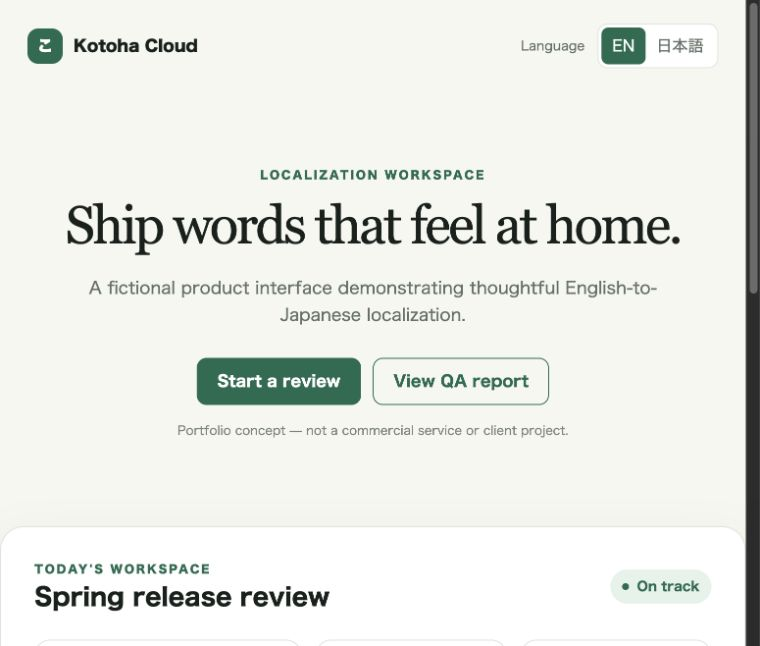
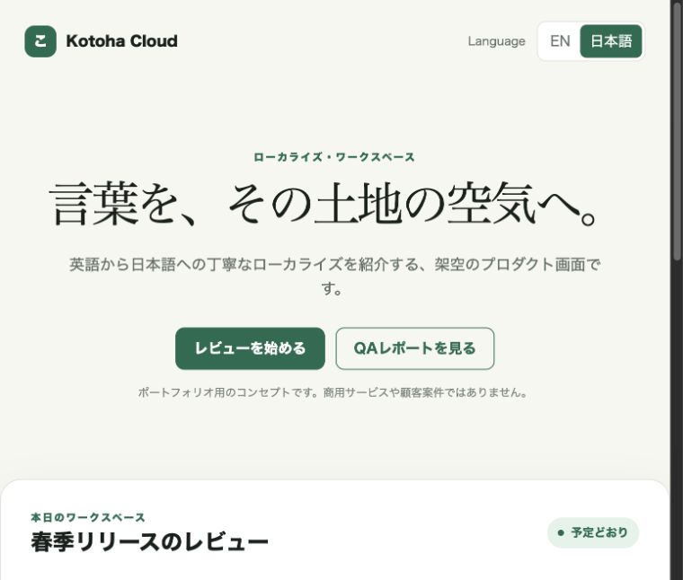

# Japanese Localization Portfolio

[](https://github.com/soraxiom-source/japanese-localization-portfolio/actions/workflows/test.yml)

An original, dependency-free portfolio project demonstrating an
English-to-Japanese localization workflow: bilingual UI implementation,
structured resource files, automated QA, contextual copy review, and CI.

> **Portfolio disclosure:** Kotoha Cloud is a fictional concept created for
> this repository. It is not a commercial service, commissioned project, or
> claim of client work.

## English / Japanese comparison

| English UI | Japanese UI |
| --- | --- |
|  |  |

The responsive demo switches languages without reloading the page and stores
the selected locale locally in the browser.

## What this project demonstrates

- English and Japanese UI with an accessible language control
- Nested [JSON](locales/en.json) and matching [YAML](locales/en.yaml) resources
- Exact translation-key parity checks
- Named-placeholder validation, including `{name}`, `{count}`, and `{amount}`
- Empty-value, whitespace, control-character, and replacement-character checks
- Conservative Japanese quality hints for untranslated or potentially awkward copy
- Contextual [localization rationale](docs/localization-notes.md)
- Unit tests for passing catalogs and intentional failure cases
- GitHub Actions QA on pushes and pull requests
- Responsive layout with no external font, script, or image requests

## Run the demo

Python 3 is the only local requirement.

```bash
python3 -m http.server 8000
```

Open `http://localhost:8000`, then use **EN / 日本語** in the header.

## Run localization QA

```bash
python3 scripts/localization_qa.py --warnings-as-errors
```

Expected result:

```text
Checked localization catalogs: 0 error(s), 0 warning(s).
```

The command exits non-zero for structural errors. With
`--warnings-as-errors`, review hints also fail CI so they cannot be overlooked.
The included YAML files intentionally use a small, documented subset; the
dependency-free checker validates their paired structure rather than claiming
to be a general YAML parser.

## Run tests

```bash
python3 -m unittest discover -s tests -v
```

The test suite covers the real catalogs and failure fixtures for missing and
extra keys, mismatched placeholders, invalid characters, untranslated English,
style hints, YAML parity, and UI-to-catalog key coverage.

## Project structure

```text
.
├── .github/workflows/test.yml   # GitHub Actions workflow
├── docs/localization-notes.md   # Translation decisions and QA approach
├── locales/                     # English/Japanese JSON and YAML resources
├── screenshots/                 # Actual English/Japanese demo captures
├── scripts/localization_qa.py   # Dependency-free validation CLI
├── tests/                       # Automated QA tests
├── app.js                       # Locale loading and interpolation
├── index.html                   # Original fictional product UI
└── styles.css                   # Responsive visual design
```

## Human review and AI-assisted translation

Automated validation can catch structural mistakes; it cannot reliably judge
intent, tone, cultural fit, product context, or every case of natural Japanese.
Any machine-translated or AI-assisted copy must be reviewed by a qualified
human before it is published. The QA hints in this repository are designed to
support that review, not replace it.

## Originality, dependencies, and license

The interface, copy, code, and localization examples were created specifically
for this portfolio. No client assets or third-party product materials are
included. The app and QA tool have no package dependencies and use browser APIs,
system font fallbacks, and the Python standard library. The CI workflow uses
official GitHub actions; details are in [THIRD_PARTY_NOTICES.md](THIRD_PARTY_NOTICES.md).

The project is available under the [MIT License](LICENSE).
